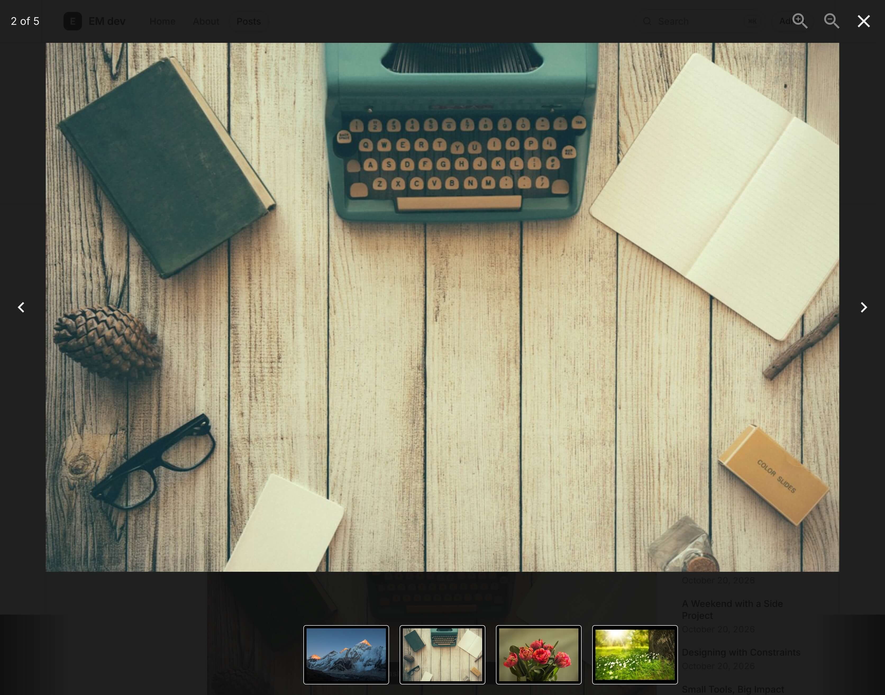

# emdash-popcase

A native EmDash lightbox plugin with [Yet Another React Lightbox](https://yet-another-react-lightbox.com/).

Popcase supports images, linked videos, and YouTube links in the same viewer.



Live Demo: https://my-emdash-site.harryzhxu.workers.dev/posts/popcase-demo

## Installation

Requires EmDash 1.3.1+, Astro 7, React, React DOM, and `@astrojs/react`.

```sh
pnpm add emdash-popcase
```

Add the configuration below to `astro.config.mjs` (or `astro.config.ts`) in your EmDash site's root directory, next to `package.json`. Keep your existing settings and plugins, and register `react()` only once.

```ts
import react from "@astrojs/react";
import emdash from "emdash/astro";
import { popcase, popcaseIntegration } from "emdash-popcase";
import { defineConfig } from "astro/config";

export default defineConfig({
  integrations: [
    react(),
    popcaseIntegration(),
    emdash({
      // Your database and storage configuration.
      plugins: [popcase()],
    }),
  ],
});
```

Register `popcaseIntegration()` before `emdash()`. Your theme must render `EmDashHead` with the content page context and collection, and use `PortableText` from `emdash/ui` for body content. The blog template already does this. Custom block renderers take precedence over Popcase's renderers.

The integration buffers public HTML responses, which disables streaming. If your site caches full responses, wrap this integration with the cache so it stores the processed HTML. Rebuild and redeploy after installation or project configuration changes.

## Admin settings

Open Popcase in the admin sidebar or visit `/_emdash/admin/plugins/popcase/settings`. Requires `plugins:manage`.

- "Enable all content types" is checked by default and includes future types.
- Uncheck it to select types individually. The selection starts empty; new types stay disabled until selected.
- "Enable thumbnails" adds a clickable strip below the image. It is off by default.
- "Autoplay videos" controls linked video files and YouTube playback in the viewer; it is on by default.
- Click "Save settings" to apply changes to existing and new content. An empty content type selection disables Popcase everywhere.

The page lists all registered content types, including hidden types and types without routes. Switching back to individual selection clears earlier selections.

The former `collections` factory option has been removed. Sites without saved admin settings enable all content types, including those excluded by older project configuration. Use the admin page to restrict them.

For cached or prerendered pages, invalidate the cache or rebuild after changing settings.

## Using a different image in the viewer

By default, an image opens its own source. To use a separate preview, set the preview image's "Link URL" to the viewer image's public URL.

Use a direct URL with a supported image-file extension. Extensionless URLs also work when they match an image reference known to the rendered block. Other links keep their normal navigation.

For inline HTML, choose the HTML block's "Inline" mode:

```html
<a href="/images/full.jpg">
  
</a>
```

## Supported content and limitations

### Linked video files

Text and image links to `.mp4`, `.webm`, or `.ogv` files open in the viewer with native playback controls.

### YouTube

Text and image links to YouTube videos and Shorts load a player on demand in the same viewer, preserving linked start times.

### Images and other content

Popcase supports local media and direct image URLs, excluding featured images, listing cards, avatars, cover backgrounds, isolated iframes, third-party blocks, and editing surfaces.

## Development

Use Node.js 24+ and pnpm 12 with the self-contained `example/` site.

```sh
pnpm install
pnpm format         # Format source and documentation
pnpm format:check   # Check formatting without changing files
pnpm build          # Compile server code and generate declarations
pnpm build:example  # Build the example site
pnpm test
pnpm typecheck
pnpm dev
pnpm test:package
```

`pnpm test:package` installs the tarball in a temporary consumer, checks public types, builds it, and verifies rendered output over HTTP; CI also runs tests and type checks.

Use `?case=video` or `?case=youtube` for video examples, and `?case=nojs` or `?case=fail` for fallback checks; the failed-module case requires a production build.

Rebuild after server code changes when using a linked checkout.

## Using a local checkout

Add `"emdash-popcase": "link:../emdash-popcase"` to a sibling site's dependencies. Run `pnpm install` and `pnpm build` in this repository, then install the site's dependencies. After publishing, replace the link with a registry version, for example `pnpm add emdash-popcase@0.1.0`.

Source code is licensed under MIT. Dependencies retain their own licenses.
