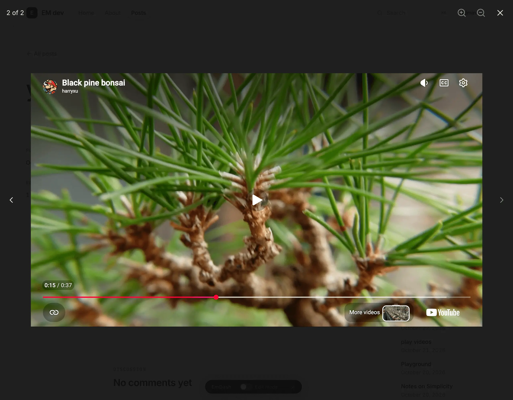
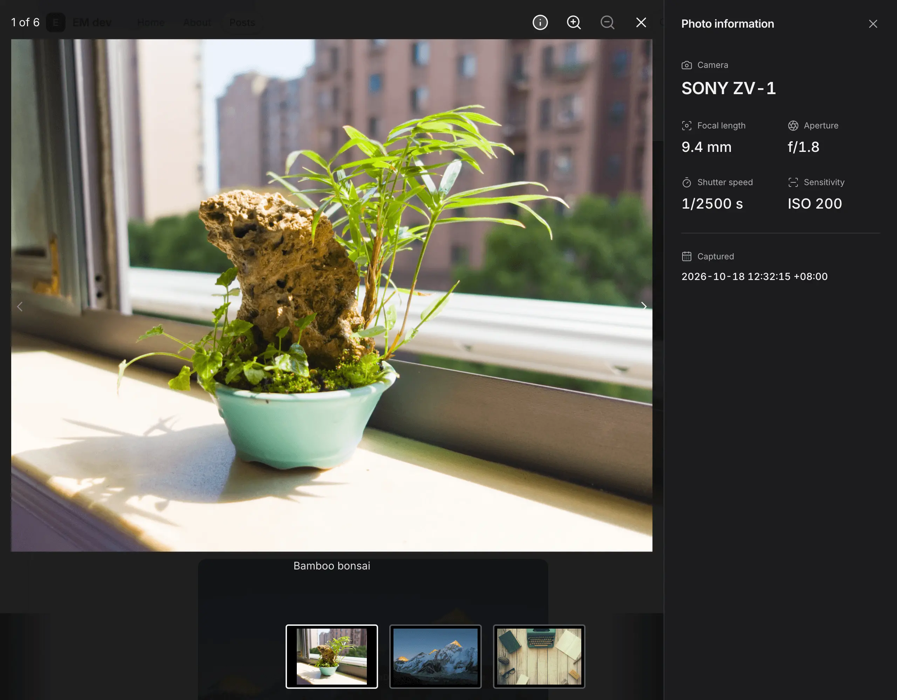
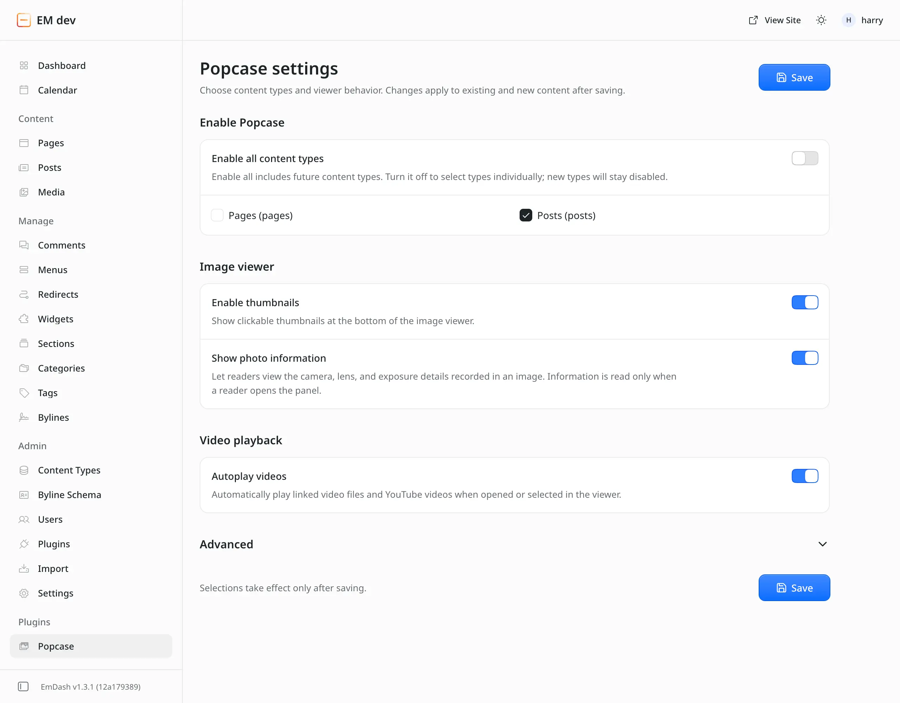

# emdash-popcase

A native EmDash image and video viewer powered by [Yet Another React Lightbox](https://yet-another-react-lightbox.com/).

- Open body images and galleries with zoom, captions, and optional thumbnails.
- View linked video files and YouTube videos in the same viewer.
- Explore camera, lens, and exposure information in an optional EXIF panel.
- Navigate with a keyboard or touch, with image links available without JavaScript.


[Live demo](https://my-emdash-site.harryzhxu.workers.dev/posts/popcase-demo)

## Installation

Requires EmDash 1.3.1+, Astro 7, React, React DOM, and `@astrojs/react`.

```sh
pnpm add emdash-popcase
```

Add Popcase to your existing `astro.config.ts` or `astro.config.mjs`, keeping your database, storage, and other plugins. Register `react()` only once and place `popcaseIntegration()` before `emdash()`.

```ts
import { defineConfig } from "astro/config";
import react from "@astrojs/react";
import emdash from "emdash/astro";
import { popcase, popcaseIntegration } from "emdash-popcase";

export default defineConfig({
  integrations: [
    react(),
    popcaseIntegration(),
    emdash({
      // Keep your existing database and storage configuration.
      plugins: [popcase()],
    }),
  ],
});
```

Rebuild and redeploy, then open Popcase in the admin sidebar to adjust viewer settings. See the [setup guide](docs/usage.md) for integration requirements and configuration details.

## Screenshots

<table>
<tr>
<td width="33%" valign="top">

### Youtube Support
<a href="images/screenshot-youtube.webp"></a>
Auto-detect YouTube links.

</td>

<td width="33%" valign="top">

### Photo Information
<a href="images/screenshot-exif.webp"></a>
View the EXIF information of the photo.

</td>
<td width="33%" valign="top">

### Settings
<a href="images/screenshot-settings.webp"></a>
Configurable settings for the viewer.

</td>

</tr>
</table>


## Documentation

- [Setup, settings, and supported content](docs/usage.md)
- [Photo information and standalone EXIF plugin](docs/photo-information.md)
- [Development and verification](docs/development.md)
- [Releasing to npm](docs/releasing.md)

## Development

Use Node.js 24+ and the pnpm version in `package.json`.

```sh
pnpm install --frozen-lockfile
pnpm dev
```

The self-contained `example/` site includes synthetic media. Build commands, tests, fixture scenarios, and local checkout instructions are in the [development guide](docs/development.md).

## License

[MIT](LICENSE). Dependencies retain their own licenses.
